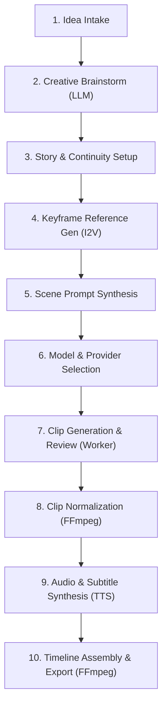

# AI Video Creation Platform Architecture
*Production Workflow, Technology Stack, Continuity Strategies, and Media Processing*

---

## Executive Overview
This document captures the production-ready architecture for an end-to-end AI video creation platform. The platform transforms an initial concept into a structured creative brief, a scene-by-scene script with visual continuity, model-ready prompts and keyframe references, generated video clips, and an assembled, polished final video with synchronized narration and background music.

The architecture strictly enforces separation of concerns across three core pillars:
1. **Creative Planning & Continuity Engine**: LLMs for brainstorming and script breakdown, coupled with image models for character sheets and keyframe reference generation.
2. **Video Generation Layer**: A vendor-agnostic Provider Adapter Layer (`submit`, `getStatus`, `cancel`) isolating the core platform from model-specific API variations (Google Veo, Runway Gen-3, Luma Dream Machine, Kling AI, Azure OpenAI / Foundry).
3. **Media Post-Processing & Normalization**: An automated FFmpeg worker pipeline that normalizes raw takes, synthesizes TTS voiceover and timed subtitles, and renders multi-track timeline exports.

The entire web application, API orchestration, and background worker infrastructure is unified on a **Single-Stack TypeScript Architecture**, maximizing code reuse, end-to-end type safety, and operational simplicity.

---

## 1. Product Workflow (10-Stage Pipeline)



| Stage | What Happens | Key Outputs & Guardrails |
| :--- | :--- | :--- |
| **1. Idea Intake** | Collect initial concept, desired duration, aspect ratio (`16:9`, `9:16`, `1:1`), target audience, visual genre/style, and brand constraints. | Structured Project Intake Record |
| **2. Creative Brainstorm** | Interactive LLM dialogue exploring narrative hooks, tone, pacing, and visual themes to converge on an approved creative brief. | Approved Creative Brief & Narrative Outline |
| **3. Story & Continuity Setup** | Decompose the brief into sequential scenes. Define persistent character profiles (appearance, attire, distinguishing features), environment tokens, lighting, and art style. | Scene Breakdown Table & Master Continuity Sheet |
| **4. Keyframe Reference Gen (I2V)** | Generate reference image assets (character sheets, scene keyframes) using high-fidelity image models (Flux, Midjourney, DALL-E) to visually anchor subjects. | Visual Reference Anchors for Image-to-Video (I2V) |
| **5. Scene Prompt Synthesis** | Generate editable prompts per scene combining visual continuity tokens, camera choreography (dolly, pan, crane, zoom), and action descriptions. | Model-ready Scene Prompts & Camera Parameters |
| **6. Model & Provider Selection** | Present available providers (Google Veo, Runway, Luma, Kling, Azure/Foundry) with supported durations, I2V support, cost, and estimated turnaround latency. | Provider & Model Binding per Scene |
| **7. Clip Generation & Review** | Dispatch scene requests as background jobs. Polling/webhook tracking streams real-time progress. Users can review, adjust prompts, or regenerate specific takes. | Raw Generated Video Takes |
| **8. Clip Normalization (Ingest)** | Background worker automatically inspects and normalizes raw clips to a standardized frame rate (30fps), color space (`yuv420p`), SAR 1:1, and audio sample rate (48kHz). | Standardized Clips ready for Concatenation |
| **9. Audio & Subtitle Synthesis** | Generate scene narration/voiceover via Text-to-Speech (TTS) with word-level timestamps. Generate styled timed subtitles (`.ass`/`.srt`) and select background audio. | TTS Voiceover Tracks, Subtitle Files & Music |
| **10. Timeline Assembly & Export** | FFmpeg stitches normalized clips with transition effects (dissolves, cuts), applies sidechain audio ducking under narration, burns subtitles, and exports master MP4. | Production-ready Master MP4 Video |

> [!IMPORTANT]
> **Critical Continuity Principle**: Relying exclusively on text prompts causes severe facial, clothing, and aesthetic drift between cuts in current video models. Stage 4 (Keyframe Reference Generation) is essential: generating reference keyframes first enables the use of **Image-to-Video (I2V)** conditioning across all scenes.

---

## 2. High-Level Implementation Diagram

```text
USER (Browser)
      │
      ▼
WEB APPLICATION  │  Next.js 15+ & TypeScript (App Router, Tailwind CSS, shadcn/ui)
      │
      ▼
BACKEND API & ORCHESTRATION LAYER  │  Next.js Server Actions & Route Handlers
  ├─ Creative Planning Engine (LLM): Brainstorm • Scene Breakdown • Continuity Rules
  ├─ Keyframe Generator: Consistent Visual Character & Scene Anchors (Flux / Midjourney / DALL-E)
  ├─ Database: PostgreSQL (Prisma / Supabase) — Projects, Scenes, Takes, Timeline Tracks, Jobs
  ├─ Media Storage: Object Storage (S3 / GCS / Supabase Storage) — Assets, Clips, Master Exports
  └─ Job Queue Dispatcher: BullMQ (Redis) / Cloud Tasks
      │
      ▼
TYPESCRIPT BACKGROUND WORKER SERVICE (Node.js)
  ├─ Provider Adapter Layer
  │    ├─ Google Veo Adapter (Text-to-Video & Image-to-Video)
  │    ├─ Runway Gen-3 Adapter (I2V Keyframe Conditioning & Camera Control)
  │    ├─ Luma Dream Machine & Kling AI Adapters
  │    └─ Azure OpenAI Video / Microsoft Foundry Adapter
  ├─ Polling & Webhook Listener ➔ Sync Raw Clips to Object Storage
  ├─ FFmpeg Ingestion & Normalization Engine (Standardize FPS, SAR, Colorspace)
  ├─ Audio Engine: TTS Voiceover (ElevenLabs) + Timed Subtitles (.ass) + Music Ducking
  └─ FFmpeg Timeline Assembler: Multi-track Concatenation, Transitions ➔ Master MP4 Export
```

---

## 3. Technology Stack & Language Choices

| Layer | Recommended Choice | Architectural Role & Justification |
| :--- | :--- | :--- |
| **Web Application** | **Next.js (App Router) + TypeScript** | Project workspace, interactive brainstorm chat, multi-track timeline preview, take reviewer, and export portal. |
| **UI Components** | **Tailwind CSS + shadcn/ui + Lucide** | Accessible, modular design system optimized for fast product iteration. |
| **Backend & API** | **Next.js Server Route Handlers** | Input validation (Zod), authorization, secure API key custody, LLM prompt orchestration, and queue dispatch. |
| **Primary Language** | **TypeScript (Fullstack)** | Single unified language across Web App, API, Adapters, and Worker. Shares interfaces (`Scene`, `Take`, `Job`, `ProviderConfig`) across all boundaries. |
| **Database** | **PostgreSQL (via Prisma ORM or Supabase)** | Relational schema for complex hierarchies: `Workspaces ➔ Projects ➔ Scenes ➔ Takes/Versions ➔ Timeline Tracks`. Superior to NoSQL for timeline manipulation. |
| **Authentication** | **Supabase Auth or NextAuth.js / Clerk** | User session management, role-based access control, and organization tenancy. |
| **File & Media Storage** | **AWS S3, Cloudflare R2, or Google Cloud Storage** | Durable object storage for reference images, raw generated takes, normalized clips, audio stems, and final video exports. |
| **Queue & Scheduler** | **BullMQ + Redis** | High-throughput asynchronous job queue supporting concurrency control, exponential backoff retries, progress telemetry, and job cancellation. |
| **Worker Service** | **Node.js + TypeScript Service** | Independent long-running container executing provider polling, asset downloading, FFmpeg normalization, audio generation, and assembly. |
| **Media Processing** | **FFmpeg (via fluent-ffmpeg / child_process)** | Video normalization (framerate, SAR, pixel format), audio mixing (sidechain ducking), subtitle burn-in, and timeline concatenation. |
| **Voiceover & Audio** | **ElevenLabs or OpenAI Audio API** | High-fidelity Text-to-Speech (TTS) generation with word-level timestamps for automated subtitle generation and voiceover synchronization. |

### Language Architecture Rationale (TypeScript vs. Python)
* **Why TypeScript Everywhere?**
  * All core responsibilities—invoking external AI APIs, tracking asynchronous job status, streaming media files, and spawning FFmpeg processes—are network I/O and process orchestration tasks where Node.js excels.
  * Direct type sharing between the web editor, database ORM (Prisma), provider adapters, and worker eliminates code duplication and prevents runtime type drift.
* **When would Python be introduced?**
  * Python is **not required** for standard cloud API orchestration or FFmpeg processing.
  * Python should only be added as an isolated microservice if future project phases require running local deep-learning inference (e.g., self-hosted Whisper speech models, OpenCV facial analysis, or local ComfyUI/PyTorch pipelines).

---

## 4. Provider Adapter Layer

The adapter layer provides a stable, vendor-agnostic abstraction for video generation. Each adapter translates the platform’s unified request into provider-specific API calls, validates provider constraints, and normalizes status responses.

```typescript
// Unified Provider Adapter Interface
export interface VideoGenerationRequest {
  prompt: string;
  negativePrompt?: string;
  referenceImages?: Array<{
    url: string;
    role: 'first_frame' | 'character_ref' | 'style_ref';
  }>;
  durationSeconds: number; // e.g. 5 or 10
  aspectRatio: '16:9' | '9:16' | '1:1';
  resolution?: '720p' | '1080p';
  seed?: number;
  motionIntensity?: number; // 1-10
  cameraMovement?: 'pan_left' | 'pan_right' | 'zoom_in' | 'zoom_out' | 'static';
}

export interface VideoProviderAdapter {
  readonly id: string;
  readonly name: string;
  readonly capabilities: {
    supportsImageToVideo: boolean;
    supportsCameraMotion: boolean;
    supportedAspectRatios: string[];
    maxDurationSeconds: number;
  };

  submit(request: VideoGenerationRequest): Promise<{ providerJobId: string; status: 'queued' | 'processing' }>;
  getStatus(providerJobId: string): Promise<{
    status: 'queued' | 'processing' | 'completed' | 'failed';
    progressPercent: number;
    videoUrl?: string;
    errorMessage?: string;
  }>;
  cancel?(providerJobId: string): Promise<boolean>;
}
```

### Key Provider Adapter Responsibilities:
1. **Visual Anchoring (I2V)**: Encodes keyframe images as multipart data or signed URLs for models that accept image conditioning (Runway Gen-3, Veo, Kling).
2. **Parameter Validation**: Sanitizes prompts and enforces provider-specific aspect ratio and duration restrictions before dispatch.
3. **Response Normalization**: Translates proprietary error codes and task statuses into a unified enum (`queued`, `processing`, `completed`, `failed`).

---

## 5. Background Queue, Worker & Normalization Pipeline

Multi-scene video generation requires an asynchronous, fault-tolerant job architecture:
1. **Job Enqueue**: The Web API creates a task record in PostgreSQL, enqueues a job on BullMQ (Redis), and returns a tracking ticket to the UI.
2. **Execution**: The TypeScript Worker claims the job, retrieves the scene configuration, and invokes the appropriate provider adapter.
3. **Tracking & Telemetry**: The worker polls the provider with exponential backoff (or handles webhooks) and streams status to the client via Server-Sent Events (SSE).
4. **Ingestion**: Upon provider completion, the worker downloads the raw clip to a temporary scratch volume.
5. **FFmpeg Normalization Routine**:
   Raw video clips produced by different AI models vary in framerate, pixel format, and container flags. The worker normalizes every clip using this deterministic filter chain before timeline concatenation:

```bash
ffmpeg -i raw_input.mp4 \
  -vf "fps=fps=30,scale=1920:1080:force_original_aspect_ratio=decrease,pad=1920:1080:(ow-iw)/2:(oh-ih)/2,format=yuv420p" \
  -c:v libx264 -preset fast -crf 20 \
  -c:a aac -ar 48000 -ac 2 \
  -movflags +faststart \
  normalized_output.mp4
```

6. **Durable Persistence**: The normalized video is pushed to object storage (S3/GCS) and flagged as ready for timeline assembly.

---

## 6. Video Model and Provider Choices

| Provider & Model | Strengths & Best Use Cases | Capabilities & Limitations |
| :--- | :--- | :--- |
| **Google Veo** | Natural physics, cinematic lighting, and strong adherence to complex environmental prompts. Excellent for scenic and cinematic b-roll. | Text-to-Video and Image-to-Video available via Vertex AI / Google GenAI API. |
| **Runway Gen-3 Alpha / Turbo** | Industry standard for Image-to-Video keyframe animation, precise camera motion controls (pan/zoom/tilt), and temporal consistency. | Fast generation speeds with Turbo; asynchronous task polling via Runway API. |
| **Luma Dream Machine** | Rapid generation turnaround with high-speed camera motion and fluid character motion. | Strong I2V support; available via Luma API and third-party aggregators. |
| **Kling AI & Minimax** | Exceptional character realism, human facial consistency, and realistic cloth/fluid physics. | High-resolution output (1080p); available directly or via API aggregators. |
| **Azure OpenAI / Foundry** | Enterprise data governance, compliance guarantees, and Azure VPC integration. | Managed video generation models available through Microsoft Foundry integrations. |
| **Fal.ai / Replicate (Flux + Open Video)** | Ultra-fast reference keyframe generation (Flux 1.1 Pro) and open-source video models (CogVideoX, Wan2.1). | Ideal for generating consistent keyframe reference sheets prior to video generation. |

---

## 7. Phased Delivery Roadmap

| Phase | Focus Area | Deliverables & Capabilities |
| :--- | :--- | :--- |
| **Phase 1** | **Creative Planning & Continuity Engine** | Project dashboard, LLM brainstorming chat, structured scene breakdown, character profile management, and reference keyframe generation (Flux/Midjourney) for visual anchoring. |
| **Phase 2** | **First Provider Adapter & Normalization Queue** | BullMQ + Redis worker setup, first video provider adapter (Runway Gen-3 or Veo with Image-to-Video), raw clip ingestion, FFmpeg normalization pipeline, and clip review UI. |
| **Phase 3** | **Multi-Track Audio & FFmpeg Assembly** | TTS narration engine (ElevenLabs) with timestamp synchronization, automated timed subtitle burning (`.ass`), background music ducking, transition effects, and master MP4 export. |
| **Phase 4** | **Multi-Provider Expansion & Advanced Controls** | Integration of secondary and tertiary provider adapters (Veo, Luma, Azure), timeline re-ordering and trimming UI, take versioning, and provider cost/latency benchmarking. |

---

## 8. Reference Documentation
* [Next.js Documentation](https://nextjs.org/docs)
* [BullMQ Background Job Processing](https://docs.bullmq.io)
* [FFmpeg Filters Documentation](https://ffmpeg.org/ffmpeg-filters.html)
* [Runway Developer API](https://docs.dev.runwayml.com)
* [Google Vertex AI Video Models (Veo)](https://cloud.google.com/vertex-ai/generative-ai/docs)
* [ElevenLabs Text-to-Speech API](https://elevenlabs.io/docs/api-reference)
* [Prisma ORM for PostgreSQL](https://www.prisma.io/docs)
